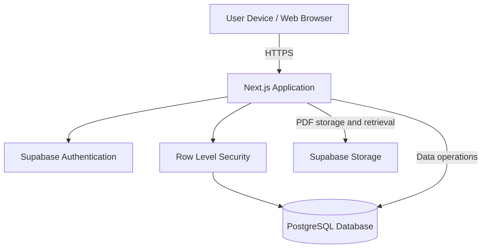
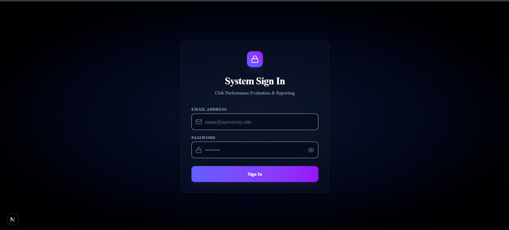
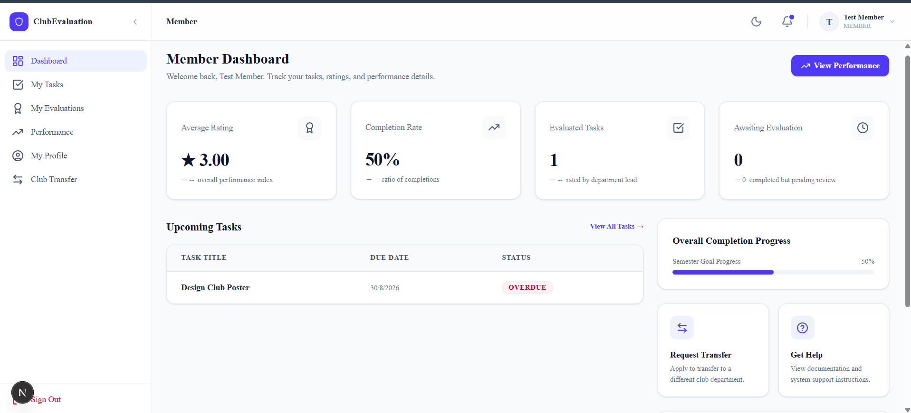
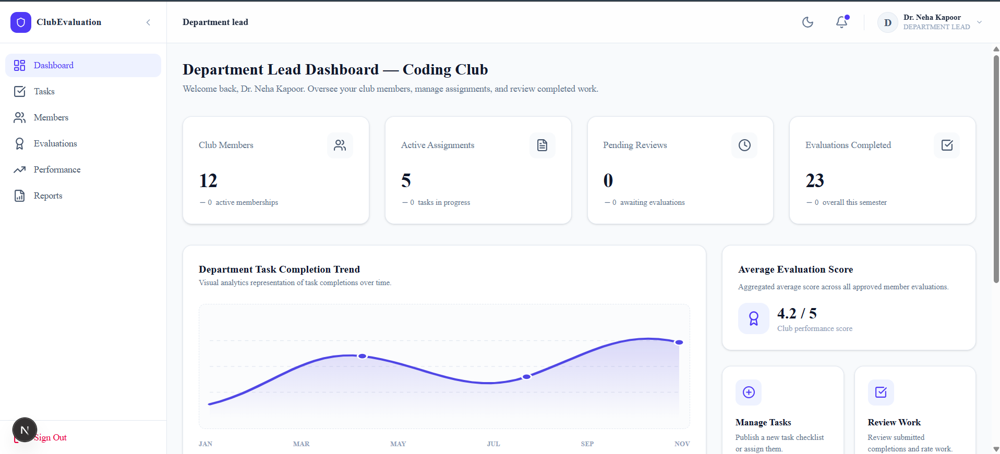
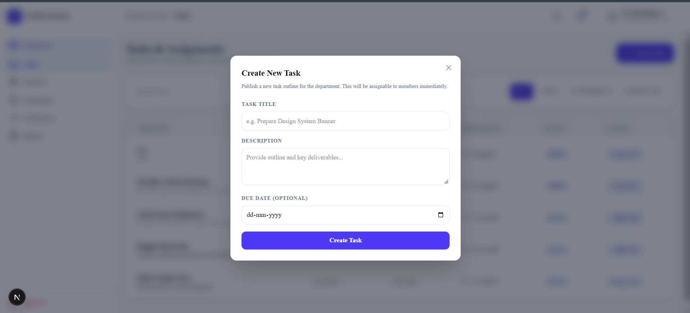
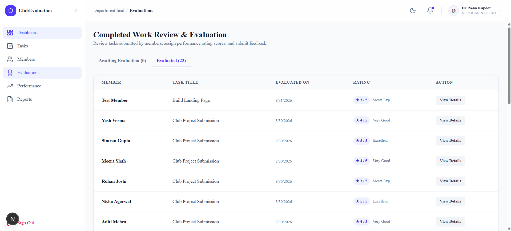
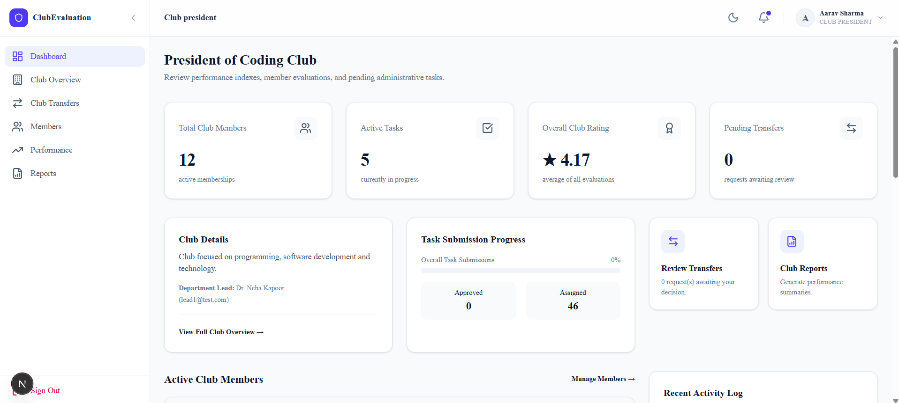
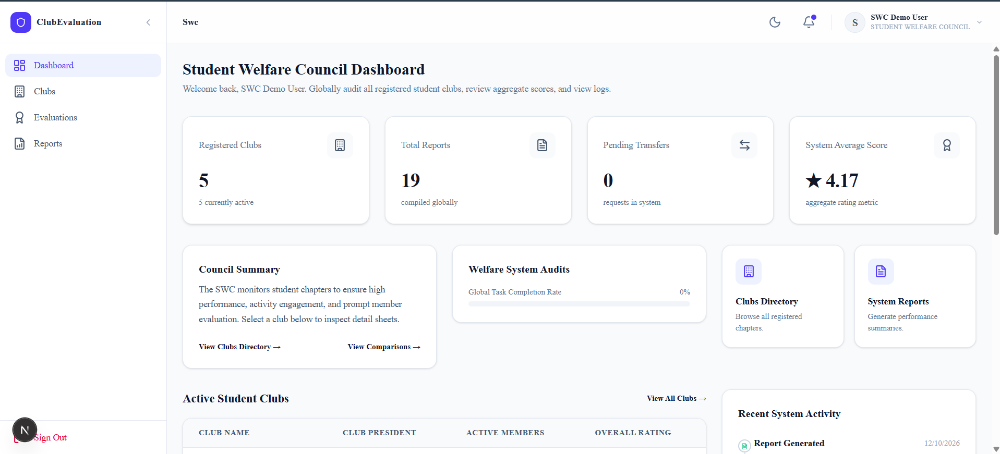
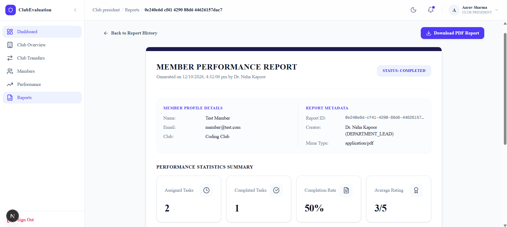

# Club Performance Evaluation and Reporting System

A centralized, role-based web application for managing student clubs, monitoring member activities, evaluating performance, and generating automated performance reports.

<p align="center">
  **Built with Next.js · React · TypeScript · Supabase · PostgreSQL**
</p>

---

## Project Overview

The Club Performance Evaluation and Reporting System is designed to simplify and centralize the management of student clubs and their members.

The platform connects task assignment, task submission, evaluation, performance tracking, club management, and report generation within a single application.

It provides separate dashboards and permissions for four stakeholder roles:

- Member
- Department Lead
- Club President
- Student Welfare Council (SWC)

The system aims to improve transparency, consistency, accountability, and efficiency in club performance management.

## Problem Statement

Student club activities and member performance are often managed using disconnected spreadsheets, documents, messages, and manually maintained records.

This creates difficulties in:

- Assigning and tracking tasks.
- Monitoring task completion.
- Maintaining consistent member evaluation records.
- Tracking individual and club performance over time.
- Managing membership and club transfers.
- Preparing performance reports manually.
- Providing centralized access to club information.

A unified platform is needed to connect these activities and provide a structured performance management workflow.

## Research Gap

Existing approaches such as spreadsheets, online forms, generic task management applications, and manually prepared reports address individual parts of club administration.

However, these approaches do not necessarily provide an integrated workflow connecting task assignment, submission review, structured member evaluation, performance aggregation, club-level monitoring, and automated reporting.

This project addresses that gap by combining these activities in one role-based system with centralized data management and reporting capabilities.

## Objectives

1. Centralize club member and performance management.
2. Implement role-based access for different stakeholders.
3. Streamline task assignment and submission.
4. Provide structured member evaluation and rating.
5. Automatically calculate and track performance.
6. Maintain member performance history.
7. Support club membership and club-switch management.
8. Automate member and club performance report generation.
9. Generate downloadable PDF reports.
10. Reduce manual effort and improve consistency in club evaluation.

## Key Features

### 1. Authentication and Role-Based Access

- Secure user authentication.
- Role-based dashboards.
- Access control using Supabase Row Level Security (RLS).
- Separate permissions for each stakeholder.

### 2. Member Management

- Member dashboard.
- Assigned task tracking.
- Task submission.
- Evaluation results.
- Individual performance history.
- Club membership history.

### 3. Task Management

- Department Leads assign tasks to members.
- Members view their assigned tasks.
- Members submit task completions.
- Leads review submissions.

### 4. Evaluation and Performance Tracking

- Department Leads evaluate submitted work.
- Structured rating records.
- Aggregate performance score calculation.
- Member performance history.
- Club-level performance statistics.

### 5. Club Management

- Club directory.
- Club membership monitoring.
- Club President and Department Lead information.
- Club transfer request management.
- Club-wise performance summaries.

### 6. Automated Reporting

- Individual member performance reports.
- Club performance summary reports.
- PDF generation.
- Secure report storage.
- Report history, viewing, and downloading.

### 7. Student Welfare Council Dashboard

- System-wide club directory.
- Global performance monitoring.
- Aggregate evaluation statistics.
- Club comparisons.
- System reports.
- Recent system activity monitoring.

## User Roles and Responsibilities

| Role | Main Responsibilities |
|---|---|
| Member | View tasks, submit work, track evaluations and performance |
| Department Lead | Assign tasks, review submissions, evaluate members |
| Club President | Monitor club activities, members and performance reports |
| Student Welfare Council | Monitor registered clubs and system-wide performance |

## System Workflow

The main performance evaluation workflow is:

```text
User Authentication
        |
        v
Role Identification
        |
        v
Task Assignment
        |
        v
Task Submission
        |
        v
Submission Review
        |
        v
Evaluation and Rating
        |
        v
Performance Aggregation
        |
        v
Performance History
        |
        v
Report Generation
        |
        v
PDF Export
```

## System Architecture

The application follows a web-based architecture with a Next.js application layer and Supabase cloud backend.



### Main Application Components

- Authentication and role management
- Role-based dashboards
- Task assignment and submission
- Evaluation and rating
- Performance aggregation
- Club and membership management
- Report generation and PDF export

## Technology Stack

| Technology | Purpose |
|---|---|
| Next.js | Application framework |
| React | User interface |
| TypeScript | Type-safe development |
| Tailwind CSS | Styling and responsive layouts |
| Supabase | Backend services |
| PostgreSQL | Relational database |
| Supabase Auth | User authentication |
| Supabase RLS | Database access control |
| Supabase Storage | PDF report storage |
| jsPDF | PDF generation |

## Database Overview

The system uses a PostgreSQL relational database managed through Supabase.

Core database entities include:

- `users` - User profiles and roles.
- `clubs` - Registered student clubs.
- `memberships` - Club membership records.
- `tasks` - Tasks created for club activities.
- `task_assignments` - Member task assignments.
- `task_completions` - Task submission and completion records.
- `evaluations` - Member evaluation and rating records.
- `club_transfer_requests` - Club transfer requests.
- `reports` - Generated report records.

Database access is controlled through authentication and Row Level Security policies.

## Project Structure

```text
club-performance-evaluation-system/
│
├── docs/                   # Project documentation
├── public/                 # Static assets
├── src/
│   ├── app/                # Next.js application routes
│   │   ├── api/            # API routes
│   │   ├── member/          # Member module
│   │   ├── department-lead/ # Department Lead module
│   │   ├── club-president/  # Club President module
│   │   └── swc/             # SWC module
│   │
│   ├── components/         # Reusable UI components
│   └── lib/                # Database and application utilities
│
├── supabase/               # Supabase configuration and migrations
├── tests/                  # Project tests
└── README.md
```

## Getting Started

### Prerequisites

- Node.js
- npm
- A Supabase project
- Git

### Installation

Clone the repository:

```bash
git clone https://github.com/VedSuvariya/club-performance-evaluation-system.git
```

Navigate into the project:

```bash
cd club-performance-evaluation-system
```

Install dependencies:

```bash
npm install
```

### Environment Configuration

Create a `.env.local` file in the project root.

Add the Supabase environment variables required by the application. Check the Supabase client configuration in `src/lib` for the exact variable names.

Do not commit `.env.local` or expose Supabase service-role keys.

### Run the Application

```bash
npm run dev
```

Open:

```text
http://localhost:3000
```

## Documentation and UML Diagrams

The project documentation includes UML models describing the system structure and behavior.

Diagrams include:

- Use Case Diagram
- Class Diagram
- Activity Diagrams
- Sequence Diagrams
- Statechart Diagram
- Component Diagram
- Deployment Diagram

Add the exported diagram images to the `docs/` directory and link them here as they are uploaded.

## Results

The implemented system supports the main workflow from task assignment through evaluation and report generation.

Key outcomes include:

- Separate dashboards for all four stakeholder roles.
- Centralized club and member management.
- Task assignment and submission workflow.
- Structured member evaluation.
- Performance aggregation and history.
- Club transfer management.
- Club-level and system-wide monitoring.
- Automated PDF report generation and storage.

## Future Scope

- Enhanced performance analytics and visualizations.
- Additional reporting and comparison capabilities.
- Expanded audit logging.
- More comprehensive automated testing.
- Further improvements to security and usability.

## Contributors

**Project Team**

- Suvariya Ved Madhusudan
- Rajprohit Harshvardhan

---

## License

This project is developed for academic purposes. Add an appropriate open-source license before permitting reuse or redistribution.
---

## Application Screenshots

### 1. Login Page


### 2. Member Dashboard


### 3. Department Lead Dashboard


### 4. Task Assignment


### 5. Evaluation and Rating


### 6. Club President Dashboard


### 7. Student Welfare Council Dashboard


### 8. Generated Performance Report

