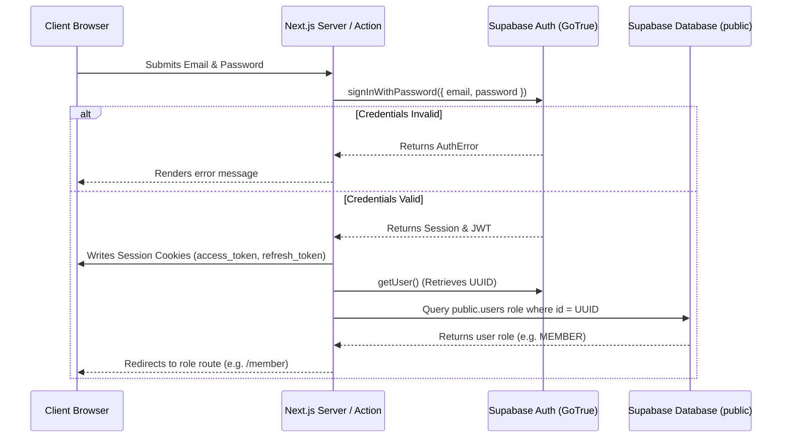

# Authentication Architecture

This document describes the design and flow of the authentication layer for the **Club Performance Evaluation and Reporting System**.

---

## 🔐 Overview

The application utilizes **Supabase Auth** as the identity and authentication provider, paired with a Next.js App Router server integration. Users log in with an email and password. Session management is strictly synchronized via cookies rather than relying only on local storage, enabling robust server-side validation.

---

## 🔄 Authentication Flow



---

## 👥 Auth Relationship with `public.users`

Authentication credentials and core account lifecycle are handled in the `auth` schema by Supabase (specifically `auth.users`). However, application business logic and roles are encapsulated within the `public.users` profile table.

### ⚡ Database Synchronization Trigger
To keep these schemas in sync without complex application logic, a database trigger automatically duplicates newly created authentication accounts into the application profiles table:

```sql
CREATE OR REPLACE FUNCTION public.handle_new_user()
RETURNS trigger AS $$
BEGIN
  INSERT INTO public.users (id, email, full_name, role)
  VALUES (
    new.id,
    new.email,
    COALESCE(new.raw_user_meta_data->>'full_name', ''),
    COALESCE(new.raw_user_meta_data->>'role', 'MEMBER')
  );
  RETURN NEW;
END;
$$ LANGUAGE plpgsql SECURITY DEFINER;

CREATE OR REPLACE TRIGGER on_auth_user_created
  AFTER INSERT ON auth.users
  FOR EACH ROW EXECUTE FUNCTION public.handle_new_user();
```

---

## 🍪 Session & Cookie Management

The system uses `@supabase/ssr` to implement secure session storage:
1. **Cookie Syncing**: The `createSupabaseServerClient` helper uses the Next.js `cookies` store to save authentication tokens (access token, refresh token) as HTTP-only cookies.
2. **Middleware Refresh**: Next.js Middleware (`src/middleware.ts`) intercepts requests on every page load to verify the user session. If the token is close to expiry, the middleware automatically calls `supabase.auth.getUser()`, which silently triggers a token refresh and updates the response cookies.
3. **Invalidation**: When logging out, `logoutAction()` calls `supabase.auth.signOut()`, clearing the cookies and destroying the session server-side.
