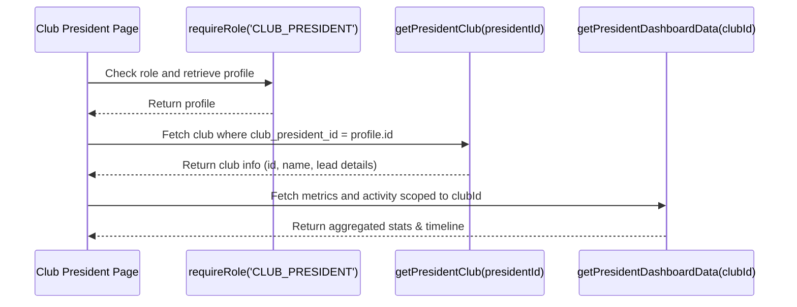

# Club President Administrative Workflow Architecture

This document outlines the architecture, data queries, security boundary controls, and workflows designed for the **Club President** role in the Club Performance Evaluation and Reporting System.

---

## 🔑 Role Scope & Permissions
A Club President has administrative and oversight authority restricted entirely to the club they manage.
- **Authority**: Access club overview, view active members roster, inspect detailed member performance indexes, read evaluation logs, and review club-related transfer requests.
- **Data Scoping**: Strictly bound to the club where `clubs.club_president_id = user_id`. They are prevented from viewing or editing data belonging to other clubs.

---

## 🏛️ Managed Club Context & Data Resolution
All Club President routes resolve the managed club dynamically on the server side using the authenticated user's ID:



If the president is not assigned to manage any club in the database, the system outputs a clear, user-friendly empty state screen instead of throwing errors or showing generic placeholders.

---

## 🔒 Security Boundaries & Data Isolation
To prevent cross-club data leakage, the following design constraints are enforced:

### 1. No Parameter Manipulation in URLs
President routes (such as `/club-president/club`, `/club-president/members`, and `/club-president/performance`) do not include the `clubId` as a URL query or path parameter. Instead, the `clubId` is resolved server-side from the session profile. This prevents malicious users from changing URLs to access other clubs' details.

### 2. Member Detail Containment
When viewing a specific member's performance details at `/club-president/members/[memberId]`, the page invokes:
```typescript
const performance = await getMemberClubPerformanceDetails(club.id, params.memberId);
```
Inside this query, a database check confirms that the member has an active membership record in the President's `club.id`. If the member belongs to a different club, the function returns `null`, displaying a secure "Member Not Found" page.

### 3. Secure Transfer Reviews
The server action `reviewTransferAction` is secured with two checks:
1. It retrieves the reviewer's managed club.
2. It queries the transfer request target and current clubs.
3. It validates that the managed club matches either the current or new target club of the request. If they do not match, it returns an unauthorized error.

---

## 📈 Dashboard Analytics
The President's dashboard displays real database-derived analytics:
- **Total Club Members**: Active memberships.
- **Active Tasks**: Count of tasks with status `OPEN` or `IN_PROGRESS`.
- **Overall Club Rating**: Average score across all task evaluations.
- **Completion Rate**: Percentage of assigned tasks that are approved.
- **Recent Activity Log**: A unified chronological feed of recent task completions, evaluation submissions, and transfer requests related to the club.
