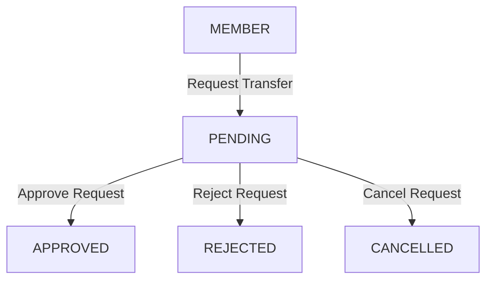

# Club Transfer Workflow Architecture

This document describes the design, database transactions, authorization controls, and lifecycle rules of the Club Transfer workflow in the **Club Performance Evaluation and Reporting System**.

---

## 🔄 Transfer Request Lifecycle

A transfer request follows an explicit state transition sequence:



- **PENDING**: The request is created by the Member and is awaiting review.
- **APPROVED**: The Club President has accepted the request. Active membership is transitioned.
- **REJECTED**: The Club President has declined the request. The member remains in their current club.
- **CANCELLED**: Optional state for request withdrawal (future extension).

---

## 👥 Roles & Authorization

### 1. Who Can Request?
- **Allowed**: Only users with the role `MEMBER` who have an active record in `public.memberships`.
- **Guards**: Resolves the user ID from the server-side authentication session. Requesting on behalf of another user is strictly blocked.

### 2. Who Can Approve/Reject?
- **Allowed**: Only users with the role `CLUB_PRESIDENT`.
- **Guards**: Enforced via `requireRole('CLUB_PRESIDENT')` on the server action. Browser-supplied claims are ignored.

---

## 🔒 Security & Data Isolation Model

1. **Self-Approval Block**: Members cannot review, approve, or reject their own transfer requests.
2. **Current Club Guard**: A member cannot request a transfer to the club they are currently an active member of.
3. **Invalid/Inactive Club Guard**: Transfers can only target active clubs. Disabled or nonexistent clubs are rejected during server-side verification.
4. **Duplicate Prevention**: A member can have at most **one** `PENDING` transfer request at a time. Attempts to create conflicting pending requests are blocked both by application repository validation and schema unique indexes.

---

## ⚙️ Membership Transition & Transaction Strategy

Approval is a critical database mutation. Since the Supabase JavaScript client does not support multi-row transaction locking natively, atomicity is enforced using a PostgreSQL database PL/pgSQL function:

```sql
SELECT ... FROM club_transfer_requests WHERE id = :requestId FOR UPDATE;
```

### When APPROVED (Atomic Transaction)
1. Verify the request status is `PENDING`.
2. Retrieve the request's target club and verify it is active.
3. Update the member's current active membership:
   - Set `status = 'INACTIVE'`.
   - Set `left_at = now()`.
4. Insert a new membership row:
   - Set `status = 'ACTIVE'`.
   - Set `joined_at = now()`.
5. Update the transfer request:
   - Set `status = 'APPROVED'`.
   - Set `decided_by = :reviewerId`.
   - Set `decided_at = now()`.

If any SQL query fails, the entire transaction is rolled back, leaving the membership state untouched.

### When REJECTED
1. Verify the request status is `PENDING`.
2. Update the transfer request:
   - Set `status = 'REJECTED'`.
   - Set `decided_by = :reviewerId`.
   - Set `decided_at = now()`.
   - Set `comments = :comments`.

*No changes are made to the memberships table when a request is rejected.*

---

## 📂 Historical Data Preservation

A core business constraint is that **club transfers must never delete or modify historical records**.

- **Membership Retention**: Past memberships are preserved as rows with `status = 'INACTIVE'`. This maintains the start/end dates of a member's tenure in each club.
- **Tasks & Completions**: Historical task assignments and completions remain bound to their original tasks, preserving the club context where the tasks were assigned.
- **Evaluations & Performance**: Evaluation records remain attached to the user ID and original task ID. They are not moved or renamed. The member's overall average rating and performance trend continue to aggregate historical evaluations from all clubs they have participated in.
