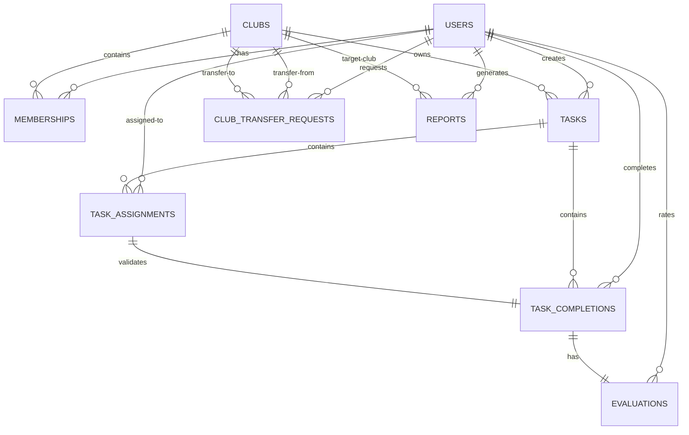

# Database Schema Architecture

This document describes the database design for the **Club Performance Evaluation and Reporting System** using Supabase PostgreSQL.

---

## 📊 Entity Relationship (ER) Diagram



---

## 🗂️ Entity List & Purpose

### 1. `users`
- **Purpose**: Mirrors/extends Supabase Auth accounts (`auth.users`) to represent the application-side user profiles.
- **Fields**:
  - `id` (UUID): Primary key, links to `auth.users(id)`.
  - `email` (TEXT): Mirrored user email.
  - `full_name` (TEXT): Display name.
  - `role` (TEXT): Application-wide role constraint (`MEMBER`, `DEPARTMENT_LEAD`, `CLUB_PRESIDENT`, `STUDENT_WELFARE_COUNCIL`).

### 2. `clubs`
- **Purpose**: Represents a club unit containing members, supervised by a Department Lead and led by a Club President.
- **Fields**:
  - `id` (UUID): Primary key.
  - `name` (TEXT): Unique club name.
  - `description` (TEXT): Purpose of the club.
  - `is_active` (BOOLEAN): State indicator.
  - `department_lead_id` (UUID): References the `users` profile leading the department.
  - `club_president_id` (UUID): References the `users` profile serving as president.

### 3. `memberships`
- **Purpose**: Manages membership history, linking members to clubs while retaining historical join and departure dates.
- **Fields**:
  - `id` (UUID): Primary key.
  - `user_id` (UUID): Reference to `users`.
  - `club_id` (UUID): Reference to `clubs`.
  - `status` (TEXT): Active, Inactive, or Suspended state.
  - `joined_at` (TIMESTAMP): Date when the member joined.
  - `left_at` (TIMESTAMP): Date when the member left the club.

### 4. `tasks`
- **Purpose**: Tasks or events generated within a club, assigned to one or more members.
- **Fields**:
  - `id` (UUID): Primary key.
  - `club_id` (UUID): Reference to the owning `clubs`.
  - `creator_id` (UUID): Reference to the creator `users`.
  - `title` (TEXT): Title of the task.
  - `description` (TEXT): Detailed requirements.
  - `status` (TEXT): `OPEN`, `IN_PROGRESS`, `COMPLETED`, `CANCELLED`.
  - `due_date` (TIMESTAMP): Completion deadline.

### 5. `task_assignments`
- **Purpose**: Junction table linking tasks to assigned members (supporting many-to-many task assignment).
- **Fields**:
  - `id` (UUID): Primary key.
  - `task_id` (UUID): Reference to `tasks`.
  - `user_id` (UUID): Reference to `users` (assigned member).

### 6. `task_completions`
- **Purpose**: Holds task completion evidence submitted by members.
- **Fields**:
  - `id` (UUID): Primary key.
  - `task_id` (UUID): Reference to `tasks`.
  - `user_id` (UUID): Reference to `users` (completing member).
  - `status` (TEXT): `SUBMITTED`, `APPROVED`, `REJECTED`.
  - `notes` (TEXT): Completion text, links, or comments.
  - `submitted_at` (TIMESTAMP): Submission date.

### 7. `evaluations`
- **Purpose**: Houses the ratings and feedback submitted by Department Leads against completed tasks.
- **Fields**:
  - `id` (UUID): Primary key.
  - `task_id` (UUID): Reference to the completed task.
  - `member_id` (UUID): Reference to the member being evaluated.
  - `evaluator_id` (UUID): Reference to the evaluating Department Lead.
  - `rating` (INTEGER): Rating value between 1 and 5.
  - `feedback` (TEXT): Written evaluation text.

### 8. `club_transfer_requests`
- **Purpose**: Tracks request status and decisions when members request to switch to a different club.
- **Fields**:
  - `id` (UUID): Primary key.
  - `user_id` (UUID): Reference to the requesting `users`.
  - `current_club_id` (UUID): Reference to their current `clubs`.
  - `new_club_id` (UUID): Reference to the requested `clubs`.
  - `status` (TEXT): `PENDING`, `APPROVED`, `REJECTED`, `CANCELLED`.
  - `reason` (TEXT): Explanation for request.
  - `decided_by` (UUID): Deciding authority.
  - `decided_at` (TIMESTAMP): Decision timestamp.
  - `comments` (TEXT): Approval/Rejection remarks.

### 9. `reports`
- **Purpose**: Holds metadata and cloud storage paths for generated PDF reports.
- **Fields**:
  - `id` (UUID): Primary key.
  - `report_type` (TEXT): `MEMBER_EVALUATION` or `CLUB_SUMMARY`.
  - `target_user_id` (UUID): Target member profile (if applicable).
  - `target_club_id` (UUID): Target club (if applicable).
  - `generated_by` (UUID): Generator `users` ID.
  - `status` (TEXT): `GENERATING`, `COMPLETED`, `FAILED`.
  - `storage_path` (TEXT): Reference URL/path to the PDF in Supabase Storage.

---

## 🔒 Important Constraints & Rules

1. **Self-Evaluation Prevention**:
   The `evaluations` table implements a database check constraint:
   ```sql
   CONSTRAINT evaluator_not_member CHECK (evaluator_id <> member_id)
   ```
   This ensures that a member can never evaluate their own work at the database layer.

2. **Active Membership Constraint**:
   To prevent a member from holding multiple active club memberships simultaneously, a partial unique index is applied on `memberships`:
   ```sql
   CREATE UNIQUE INDEX unique_active_user_membership ON memberships (user_id) WHERE (status = 'ACTIVE');
   ```

3. **Assigned Completion Constraint**:
   The `task_completions` table enforces that only members assigned to a task can submit completion entries via a composite foreign key referencing `task_assignments`:
   ```sql
   FOREIGN KEY (task_id, user_id) REFERENCES task_assignments(task_id, user_id)
   ```

4. **Task-Specific Evaluation**:
   To enforce that a task is rated only once per assigned member:
   ```sql
   UNIQUE (task_id, member_id)
   ```

---

## ⚡ Important Indexes

Indexes are set up on foreign keys and frequently queried fields to ensure fast query times:
- `idx_users_role` on `users(role)`
- `idx_memberships_user_id` on `memberships(user_id)`
- `idx_memberships_club_id` on `memberships(club_id)`
- `idx_tasks_club_id` on `tasks(club_id)`
- `idx_task_assignments_user_id` on `task_assignments(user_id)`
- `idx_task_completions_user_id` on `task_completions(user_id)`
- `idx_evaluations_member_id` on `evaluations(member_id)`
- `idx_evaluations_evaluator_id` on `evaluations(evaluator_id)`

---

## 💡 Key Design Explanations

### 1. Preservation of Historical Club Transfers
- When a user transitions to a new club (approved via `club_transfer_requests`):
  1. The existing record in `memberships` for the current club is updated: `status` changes to `'INACTIVE'` and `left_at` is set to the current date/time.
  2. A new record is created in `memberships` for the new club: `status` is set to `'ACTIVE'`, and `joined_at` is set to the current date/time.
- Because tasks, completions, assignments, and evaluations explicitly reference `user_id` and the historical `club_id` at the time of creation, they remain intact. Changing the active membership does not update or cascade delete these old records, preserving the full timeline of member activity.

### 2. Task-Based Evaluation Representation
- Evaluations are tied directly to tasks through the `evaluations` table.
- An evaluation references `task_id` and `member_id`, which must match an entry in `task_completions`. This ensures that a Department Lead evaluates the actual submitted deliverables.

### 3. Department Lead Rating Rule Enforcement
- **Database Level**: The database restricts `evaluator_id <> member_id`.
- **Application Level**: The service layer verifies the roles and permissions prior to database insert:
  1. Checks if the `evaluator`'s role is `DEPARTMENT_LEAD`.
  2. Verifies that the `evaluator_id` matches the `department_lead_id` of the `club_id` associated with the task.

### 4. Reports Relation to Members/Clubs
- The `reports` table acts as metadata registry.
- For a **Member Performance Report**, `target_user_id` points to the member's profile.
- For a **Club Summary Report**, `target_club_id` points to the target club.
- PDF generation handles the aggregation asynchronously. The PDF is stored in Supabase Storage, and the relative path is stored in `storage_path` of the `reports` metadata table.
