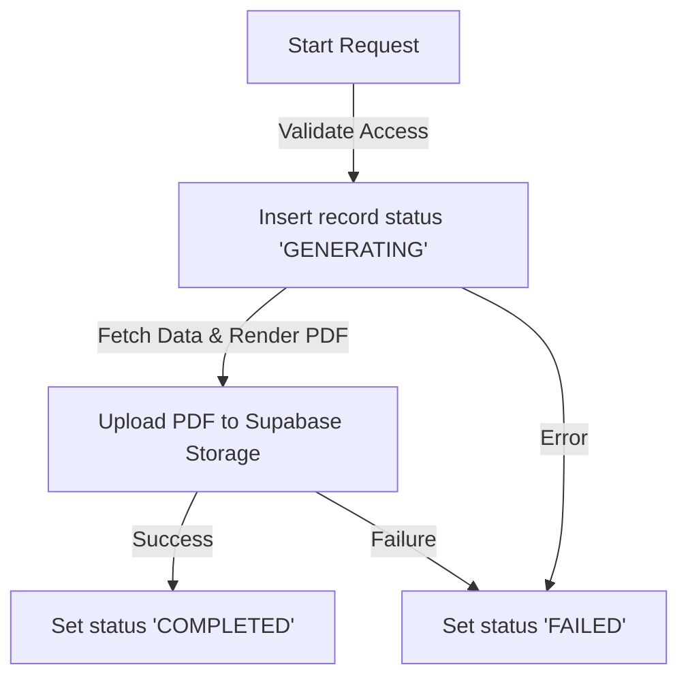

# Performance Reporting System Architecture

This document describes the design, database transactions, storage isolation, and lifecycle rules of the Performance Reporting system in the **Club Performance Evaluation and Reporting System**.

---

## 🔄 Report Generation Lifecycle

A performance report record tracks the state of PDF rendering and upload operations:

- **GENERATING**: The request is validated, and the database record is created. PDF generation and storage uploads are in progress.
- **COMPLETED**: The PDF buffer has been successfully uploaded to the private Supabase Storage bucket, and the storage path reference is saved.
- **FAILED**: An error occurred during data aggregation, PDF rendering, or uploading.

---

## 🔒 Role-Based Access Control (RBAC) & Data Isolation

To prevent cross-tenant data leaks and unauthorized statistics monitoring, access controls are enforced at both the **Generation** and **Download/Preview** layers.

### 1. Generation Permission Matrix

| Requester Role | Allowed Report Type | Scope Restrictions |
| :--- | :--- | :--- |
| **MEMBER** | `MEMBER_EVALUATION` | Can only generate a report for themselves. |
| **DEPARTMENT_LEAD** | `MEMBER_EVALUATION`, `CLUB_SUMMARY` | Can only generate reports for active members or summaries of their own managed club. |
| **CLUB_PRESIDENT** | `MEMBER_EVALUATION`, `CLUB_SUMMARY` | Can only generate reports for active members or summaries of their own managed club. |
| **STUDENT_WELFARE_COUNCIL** | `MEMBER_EVALUATION`, `CLUB_SUMMARY` | Unrestricted. Can generate reports for any club or member. |

### 2. Download and Preview Access Verification

Direct access to PDF storage references is blocked. Instead, files are downloaded via the `/api/reports/[reportId]/download` API endpoint, which performs server-side session checks:

- **SWC**: Permitted to view and download all reports.
- **MEMBER**: Only permitted to view and download reports where `target_user_id` matches their own user ID.
- **Lead / President**: Only permitted to view and download reports where `target_club_id` matches their managed club, or `target_user_id` belongs to an active member of their managed club.

---

## 📂 Supabase Storage & File Persistence Strategy

1. **Private Bucket**: Reports are saved in a private Supabase Storage bucket named `reports`. Public read/write access to the bucket is disabled.
2. **Deterministic File Naming**: Files are stored with the path format `${report_type}/${report_id}.pdf` to avoid collisions and prevent enumeration attacks.
3. **No Direct Storage Links**: The frontend UI never interacts with raw Supabase storage URLs. All operations route through the secure Next.js API Route Handler which downloads the stream directly from storage using the backend client.
4. **Metadata Linking**: Only the storage path is saved in the `reports` table. Large binary blobs are never stored directly in the PostgreSQL database.
