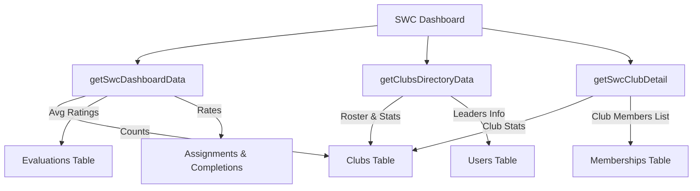

# Student Welfare Council (SWC) Administrative Workflow Architecture

This document outlines the architecture, global lookup queries, and read-only monitoring flows designed for the **Student Welfare Council (SWC)** role.

---

## 🔑 Role Scope & Permissions
The SWC is the governing student body with system-wide oversight.
- **Authority**: Access the global dashboard, inspect the directory of all registered clubs, compare club performance metrics, read global evaluations, and access generated performance summaries.
- **Read-Only Enforcements**: The SWC is strictly a monitoring authority. They are explicitly blocked from creating tasks, submitting completions, scoring evaluations, or reviewing/deciding transfer requests. All views are read-only.

---

## 🏛️ System-Wide Aggregation & Lookups
The SWC dashboard retrieves system-wide performance indices and directories using optimized query helper functions:

- **Global Average Rating**: Calculated across all evaluations in the database.
- **Global Task Completion Rate**: Calculated as the ratio of approved task completions to total task assignments across all clubs.
- **Active Student Clubs**: Lists registered clubs alongside their active member counts, average ratings, and completion rates.

---

## 📊 Performance Comparisons
The SWC Performance Comparisons page `/swc/performance` provides high-level visual comparative analytics:
- **Metrics Selection**: Allows toggling between comparing average evaluation scores (scaled 0 to 5) and task completion rates (0 to 100%).
- **Interactive SVG Charting**: Renders clean, responsive horizontal bar charts for all active clubs with members.
- **Side-by-Side Comparison Grid**: Lists active chapters, active memberships size, completion rates, and average rating scores side-by-side.

---

## 🔒 Security & Data Integrity
1. **Role Verification**: Access to `/swc` and nested routes is guarded by `requireRole('STUDENT_WELFARE_COUNCIL')` server-side, preventing members, leads, or presidents from escalating privileges.
2. **Strict Roster Boundary**: SWC accesses details of specific clubs via `/swc/clubs/[clubId]`. The route loads the club information and details only, without exposing mutative action handlers (like add task, submit work, or edit member).
