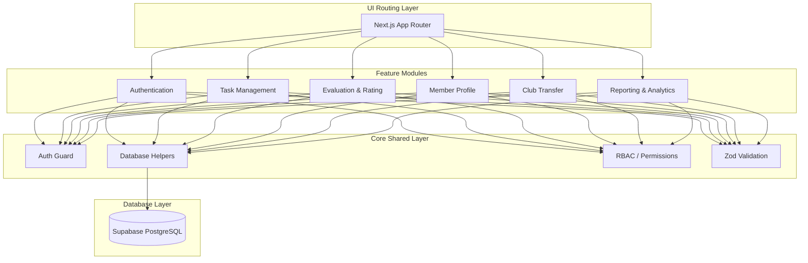

# System Architecture Overview

The **Club Performance Evaluation and Reporting System** is a secure, role-based platform designed to manage club memberships, monitor member activities, evaluate performance, handle transfers, and generate analytics reports. 

This document provides a high-level architectural overview of the system, highlighting its design principles, codebase structure, security enforcement, and data flow layers.

---

## 🏗️ Architectural Pattern: Modular Monolith

The application is structured as a **Modular Monolith**. This pattern packages domain logic into cohesive, self-contained feature modules while maintaining a shared database, routing infrastructure, and utility library. 

This layout enforces strict domain isolation, preventing spaghetti dependencies while avoiding the operational complexity of a microservices setup.



### 📂 Codebase Directory Layout

```text
src/
├── app/                  # Next.js App Router pages and page-specific layouts
├── components/           # Generic, reusable, theme-aware global UI components
├── features/             # Business domain sub-monolith packages
│   ├── authentication/   # User sign-in, session handlers, and sign-up integrations
│   ├── task-management/  # Task creation, assignment, and status updates
│   ├── evaluation/       # Performance ratings, criteria scoring, and feedback logs
│   ├── member-profile/   # User bios, contact cards, and career profiles
│   ├── club-transfer/    # Target club requests, approval workflow, and history
│   └── reports/          # Report definition schema, histories, and PDF exports
├── lib/                  # Shared system cross-cutting concern libraries
│   ├── database/         # Supabase client wrapper & feature repository helpers
│   ├── permissions/      # Role-Based Access Control (RBAC) rules
│   └── utils/            # Shared utilities (class merger, date formatters, etc.)
└── types/                # System-wide type definitions and models
```

---

## 🔒 Security & Authorization (RBAC)

Access control is enforced at multiple boundaries to ensure complete data security:

1. **Route Guarding**: Next.js middleware inspects authorization tokens and maps user profiles to verify their system roles before loading any page.
2. **Access Matrix**:
    - `/member/*` -> Limited to the authenticated `MEMBER` role.
    - `/department-lead/*` -> Restricted to `DEPARTMENT_LEAD`.
    - `/club-president/*` -> Restricted to `CLUB_PRESIDENT`.
    - `/swc/*` -> Restricted to `STUDENT_WELFARE_COUNCIL`.
3. **Database Security (RLS)**: Row-Level Security policies are configured on all PostgreSQL tables to prevent users from querying or modifying unauthorized data, even if bypassing the application frontend.

---

## 🔄 Data Flow Constraints

The system relies on a **layered, unidirectional data flow**. Direct database calls from UI components are strictly forbidden. All requests must flow down the stack sequentially:

```text
UI Component (Client or Server Side)
└── Server Action / Route API Handler
    └── Domain Service (Business Logic / Calculation)
        └── Database Repository (Query Builder / Transaction)
            └── Supabase Client Instance (PostgreSQL Interface)
```

- **UI Components**: Render views, handle client state (themes, modals), and invoke Server Actions.
- **Server Actions / Route APIs**: Validate user session tokens, enforce permission gates, and sanitize incoming parameters via Zod.
- **Domain Services**: Process business rules (e.g., computing member performance trends, preparing PDF generator layouts).
- **Database Repositories**: Formulate queries to Supabase, maps results into strict TypeScript interfaces, and catches database-level exceptions.

---

## 📊 Core Domain Integration Details

### 1. Task Lifecycle & Evaluation Sync
Tasks are assigned to members by Department Leads. Once a task is marked `COMPLETED`, it becomes eligible for evaluation. Leads submit rating scores and feedback, which automatically updates member aggregation metrics (completion rates, average scores, trends) in real time.

### 2. Club Transfer Integrity
Members can request a transfer to another active club. When approved by authorized personnel, the user's `memberships` status changes. Critically, **all historical tasks, evaluations, and performance records remain intact and associated with the user**, ensuring historical continuity.

### 3. Reporting & PDF Exports
Leads and SWC members can generate system reports based on actual database entries. Member reports compile profile metrics and history, while club reports aggregate total membership performance. Custom generator services write these directly into PDF format using vector coordinates for download.

---

## 🛠️ Verification & Quality Standards

- **Type Safety**: Explicit interfaces are declared for all database transactions, eliminating loose casts or `any` parameters.
- **Static Analysis**: ESLint and TypeScript compilation are configured to enforce clean syntax, unused variable removal, and strict null/undefined safety.
- **Testing Coverage**: 
  - **Unit & Integration**: Vitest tests verify database client operations, permissions matrix compliance, and evaluation calculators.
  - **End-to-End**: Playwright test suites simulate transfer workflows, report compilation, and user dashboard interactions.
