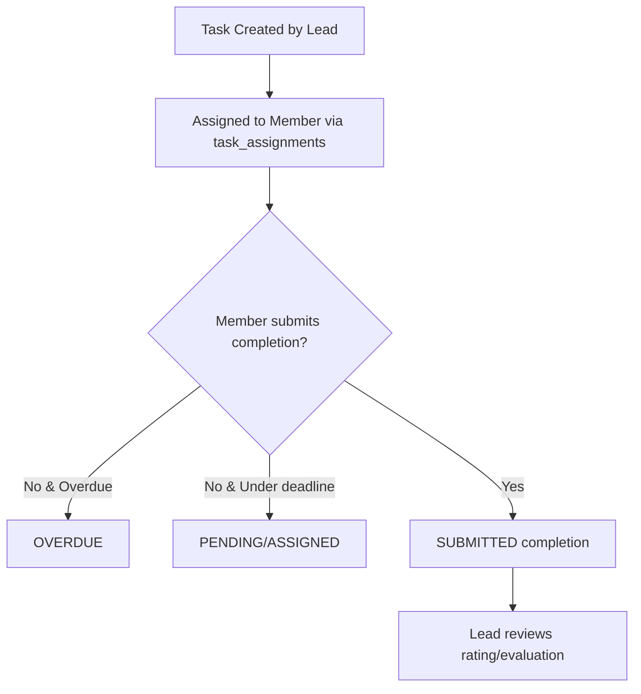

# Task Management Architecture

This document describes the Member task-consumption and completion workflow, detailing the database schema, API interactions, and safety validation guidelines.

---

## 🔄 Member Task Workflow

A member can navigate their assigned tasks, view descriptions, and submit completion reports. The lifecycle transitions as follows:



---

## 🔒 Authorization & Security Guidelines

To prevent horizontal and vertical privilege escalation, the following strict checks are enforced at the Server Action level:

1. **Session-Derived User Identity**:
   - The user profile is retrieved server-side from the Supabase auth context via `requireRole('MEMBER')`. Client-provided user IDs are completely ignored.
2. **Horizontal Privilege Escalation Protection**:
   - Every lookup or mutation (like fetching task details or marking a task as complete) executes queries constrained directly to the authenticated user's ID (`user_id = auth.userId`).
   - If a member attempts to request a task ID assigned to a different user, the database helper returns `null`, and the server routes return a safe `404 Not Found` rather than exposing forbidden details.
3. **Duplicate Submission Prevention**:
   - Prior to completion insertions, the system queries the `task_completions` table for the matching task and user IDs. If a record is found, the action rejects the submission with a message saying the task is already completed.
4. **Vertical Privilege Escalation Protection**:
   - Tasks creation, editing, and evaluation actions are restricted and require roles such as `DEPARTMENT_LEAD`. Members cannot invoke these endpoints as they will trigger role authentication checks that fail instantly.

---

## 📊 Data Flow Model

All tasks operations follow the modular monomorphic sequence:

```text
  UI / Page (Client/Server)
  └── task-management Feature Server Actions (`actions.ts`)
      └── Input validation (`zod`) & Role authorization checks (`requireRole`)
          └── Database Repository operations (`tasks.ts`)
              └── Supabase Client Queries
```

---

## 🛡️ Error Handling

- **Authentication Errors**: Unauthenticated sessions throw a standard `'UNAUTHENTICATED'` error, redirecting to the `/login` route.
- **Role Failures**: Unauthorized role requests throw `'UNAUTHORIZED'`, redirecting to `/unauthorized`.
- **Database Failures**: Raw SQL database connections or insert failures are caught server-side. A user-friendly message (`"An unexpected database error occurred."`) is returned rather than disclosing internal database schema details.
- **Validation Failures**: Zod safely parses fields (UUID formats, max characters) and returns clean validation error banners directly to the client.
